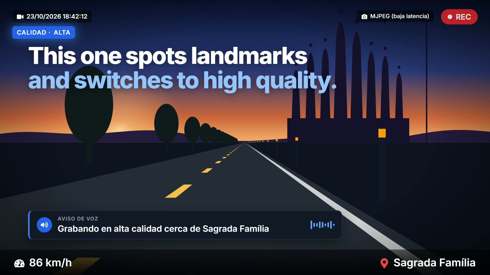

# Smart Dashcam

A Raspberry Pi dashcam that does more than record. It knows where you are, tells you out loud when you are passing a landmark, switches to high-quality recording near it, and gives you a web app (phone, tablet or in-car screen) to browse every trip.

<p align="center">
  <a href="docs/media/smart-dashcam.mp4">
    
  </a>
  <br>
  <sub>▶ <a href="docs/media/smart-dashcam.mp4">Watch the 22-second video</a></sub>
</p>

## Features

- **Dual camera recording**: road-facing Pi camera plus an interior USB webcam, with live MJPEG streams in the dashboard.
- **Landmark-aware recording**: GPS position is checked against a landmarks database (OpenStreetMap). Near a landmark the dashcam announces it and records in high quality.
- **Voice announcements**: offline neural text-to-speech with [Piper](https://github.com/rhasspy/piper) (`es_ES-carlfm-x_low`, in Spanish), with fallbacks to pyttsx3 or espeak.
- **Planned trips**: plan routes (with KML import), download offline maps and landmark data ahead of time, and let scheduled trips start automatically when the car powers on.
- **Calendar and timeline**: browse trips by day, play clips from either camera, view the GPS track and generate summary time-lapses.
- **Real-time map**: live position, speed and nearby landmarks, with offline tiles (including Organic Maps).
- **Storage management**: disk usage, a file explorer, USB drives and HDD backup.
- **External video import**: bulk-upload footage from other cameras such as an Insta360.
- **WiFi hotspot**: connect from your phone with no internet connection.
- **Safe shutdown**: when the car turns off, the trip is closed and the Pi powers down cleanly.

## Hardware

- Raspberry Pi 4 (recommended) or a compatible single-board computer
- Raspberry Pi Camera Module v2 or newer (road-facing)
- USB webcam (interior)
- GPS module (USB or GPIO)
- Power-management circuit for safe shutdown
- microSD card (32 GB+)
- Optional: WiFi adapter for the hotspot, ReSpeaker mic HAT (LED and mic support), external HDD for backups

## Software requirements

- Python 3.7+
- Node.js 14+ and npm 6+
- ffmpeg

## Quick start

```bash
git clone https://github.com/elblogbruno/dashcam-v2.git
cd dashcam-v2
./start.sh
```

`start.sh` creates the Python virtual environment, installs the backend and frontend dependencies, builds the frontend, and starts both services.

Open the dashboard at:

- `http://localhost:4173` when running locally
- `http://192.168.4.1:4173` when connected to the dashcam's WiFi hotspot

The API runs on port `8000`.

Helper scripts in `scripts/` set up the hotspot (`setup-hotspot-no-gateway.sh`), ReSpeaker drivers (`install-respeaker-drivers.sh`) and HDD mounting (`mount_hdd.sh`).

## Using the app

| Page | What it does |
|---|---|
| **Dashboard** | Live cameras, speed, location, nearby landmarks, recording and microphone controls, system status. Includes a simplified, swipeable view for in-car screens. |
| **Calendar** | Trips by date, the clip timeline, playback, GPS track and time-lapse generation. |
| **Map** | Real-time position and navigation towards planned waypoints. |
| **Trip Planner** | Create trips, import KML, and download offline maps and landmark data. |
| **Landmarks** | Browse, add, filter and bulk-manage points of interest. |
| **Storage** | Disk usage, files, USB drives and HDD backup. |
| **Settings** | Audio, video quality, hotspot, external video upload and landmark sync. |

## Development

Run backend and frontend with hot reload:

```bash
./dev.sh
```

Or run them separately.

**Backend** (Python, FastAPI):

```bash
cd backend
python -m venv venv
source venv/bin/activate
pip install -r ../requirements.txt
python main.py
```

**Frontend** (React, Vite, TailwindCSS):

```bash
cd frontend
npm install
npm run dev
```

## Project structure

```
dashcam-v2/
├── backend/                 # FastAPI backend
│   ├── main.py              # API server and startup tasks
│   ├── routes/              # REST endpoints (cameras, trips, landmarks, storage, maps…)
│   ├── landmarks/           # Landmark detection, download and settings
│   ├── geocoding/           # Reverse geocoding services and workers
│   ├── cameras/             # Camera drivers
│   ├── camera_manager.py    # Recording control
│   ├── gps_reader.py        # GPS / NMEA reader
│   ├── auto_trip_manager.py # Planned trips and landmark-aware recording quality
│   ├── audio_notifier.py    # Text-to-speech announcements (Piper)
│   ├── shutdown_monitor.py  # Safe power-down
│   ├── trip_logger.py       # Trip and GPS logging
│   └── video_maker.py       # Summary time-lapses
├── frontend/                # React web app (PWA)
├── scripts/                 # Hotspot, drivers and disk helpers
├── docs/                    # Developer notes and media
├── requirements.txt
├── start.sh                 # Production start
└── dev.sh                   # Development start
```

## License

MIT

## Acknowledgments

- Built with FastAPI, React and TailwindCSS
- Landmark data from OpenStreetMap
- Voice by Piper TTS
- Video processing with ffmpeg
